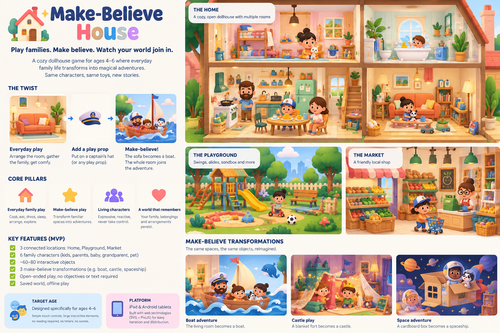

# Little Days

**Play families. Make believe. Watch your world join in.**

A cozy, open-ended dollhouse game for ages 4–6 where everyday family life transforms
into make-believe adventures — the sofa becomes a boat, a blanket fort becomes a castle,
a cardboard box becomes a spaceship — without losing the scene the child built.



> The concept board is a **mood reference**, not an approved production asset.

## Status

Concept stage (v0.1). The first milestone is the vertical slice:
**one living room → one boat adventure**, two characters, drag/drop, seating,
carrying, persistence, and a reversible sofa-to-boat transformation.

## Product principles

1. **Play first** — no missions, timers, scores or failure.
2. **Child authorship** — the child decides what happens.
3. **Continuity** — the world remembers its people, belongings and changes.
4. **Intuitive interaction** — tap, drag and drop; no reading.
5. **Wonder from ordinary things** — imaginative play grows out of everyday routines.
6. **Depth over volume** — fewer spaces with rich combinations.
7. **Safety by design** — offline-first, no ads, no social feed.

Full design and development plan: [docs/game-plan.md](docs/game-plan.md).

## North-star acceptance test

*A four-year-old independently moves a family onto a sofa, packs a snack, transforms
the sofa into a boat, plays an imaginative adventure, returns to the living room, and
finds the family and snack where they expect them.*

## Stack

TypeScript · PixiJS · Vite · modular SVG assets · local-first persistence ·
tablet-focused web/PWA. No backend for the first playable release.

## Getting started

```bash
npm install
npm run dev
```

## Contributing

Start from the [immediate next steps](docs/game-plan.md#14-immediate-next-steps) in the
plan. Keep scope to the vertical slice until it passes its playtest gate.

For an adult-facilitated session, use the [playtest guide](docs/playtest-guide.md)
and [blank observation sheet](docs/playtest-observation.md). The protocol is proposed;
child testing results have not yet been established.
