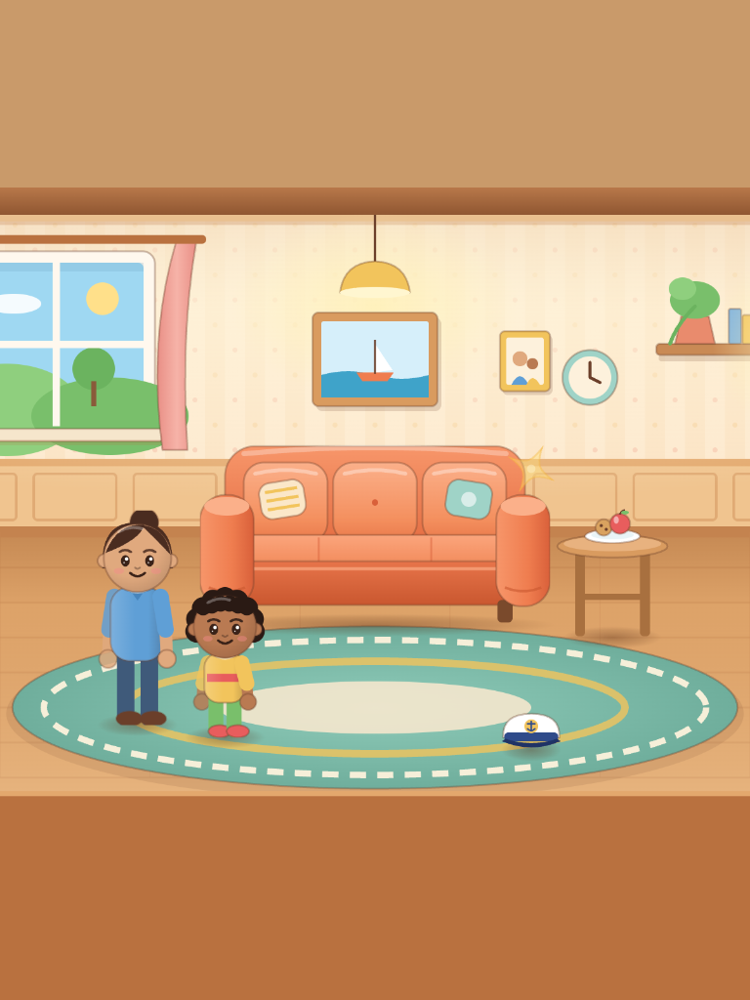
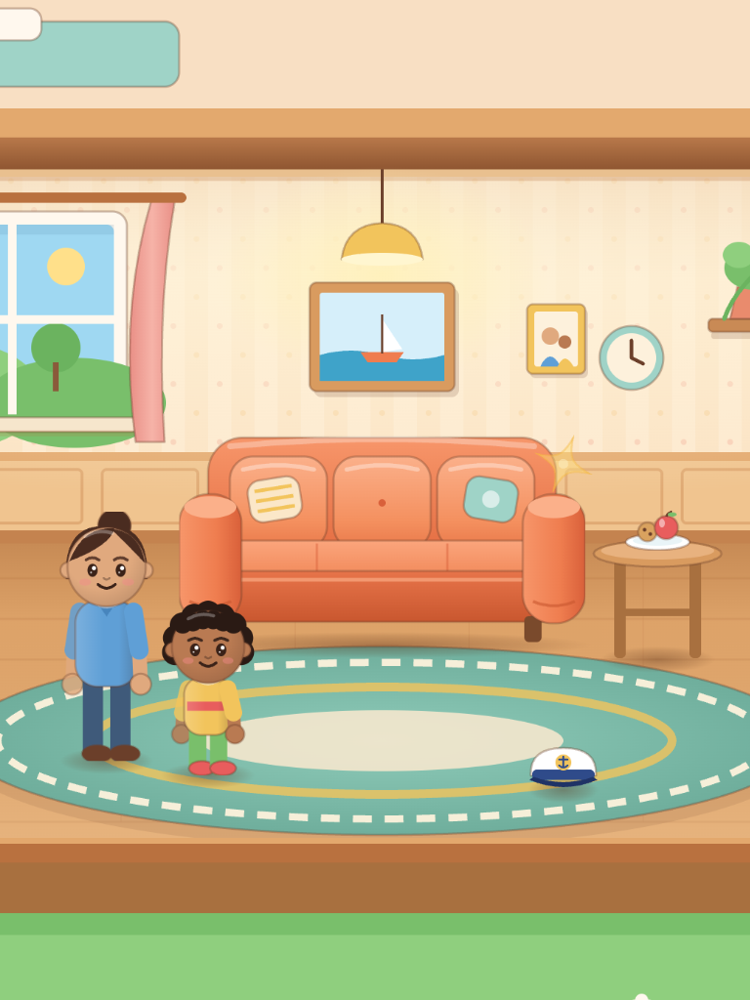
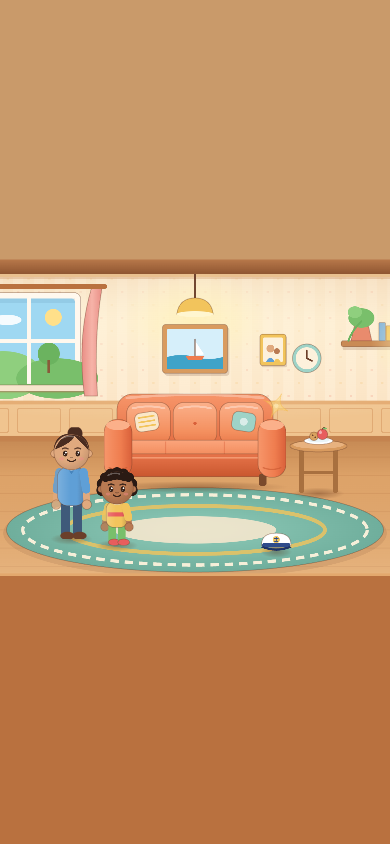
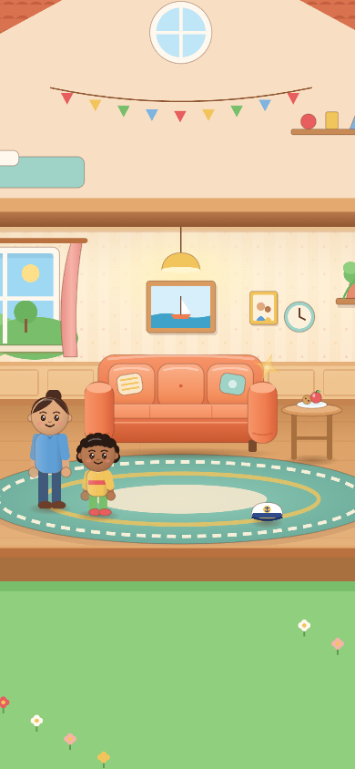
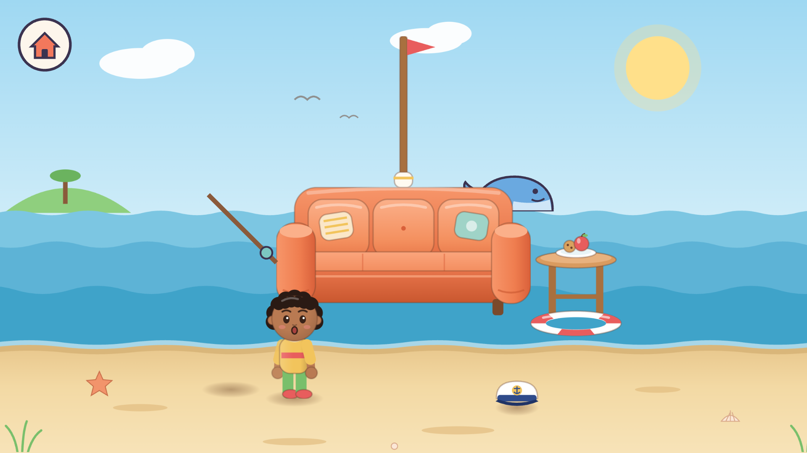
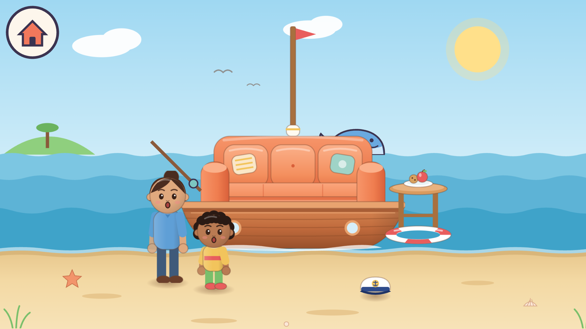

# Combined visual verification

⚠️ DEGRADED: single-context visual review (the owner prohibited additional agents).
This is browser evidence and an inline comparison, not human design acceptance or
child-playtest evidence. The mechanical shell detector used a regex fallback
because its parser dependencies were unavailable; it cannot assess Pixi canvas art.

Reference: [concept board](assets/concept-board.png), especially its warm illustrated
toy theatre, contact shadows, layered room, and expressive family. The new art adds
shading, soft contact shadows, paneling, lighting and a more readable sitting pose.
It remains a simpler SVG interpretation of the reference; owner review is needed.

The first batch used the combined first art/layout pass (`48d58ce`); confirmation
used the corrected combination (`7680be1`). Each batch opened the production game
in fresh Chromium pages at 1280×800, 768×1024, 390×844 and 1920×1080, device scale 1,
and entered the sea by tapping the visible sparkle. No page errors occurred.

| Observed case | Before | Confirmation |
| --- | --- | --- |
| Portrait tablet room zoom | 0.64 screen px/world unit | 0.741; upstairs/garden scenery replaces flat shell bands |
| Tall phone room zoom | 0.325 | 0.378; full-height scenery, with the wide play cluster still smaller than landscape |
| Visible home bubble on phone | about 74 px across | about 98 px across and pinned inside the viewport |
| Boat hull at 1920×1080 | zero opaque canvas pixels at resolution 1.35 | 138,845 opaque pixels at resolution 1.25 |
| Grown-up at 1920×1080 | shadow visible, character missing | character visible; the offline regression checks all visible textured parts |

The upstairs and garden are decorative scenery, not new playable rooms. All people
and props remain reachable; the presentation does not rearrange their saved world
positions. The phone still shows a relatively small wide play area, so the visual
choice needs the owner's approval. The manifest remains orientation-independent.

Matched captures from this combined check:

| Case | Before | After |
| --- | --- | --- |
| Portrait tablet |  |  |
| Tall phone |  |  |
| Large-screen sea |  |  |

For the original room-art and sitting-pose comparison, see the matched captures
under [art-quality](screenshots/art-quality/). Input-specific before/after captures
remain under [seating-fix](assets/seating-fix/).

Small sea-art details (a faint sky transition and sand marks that can resemble loose
shadows) remain for owner review. Physical iPads, Android tablets and Safari were
not tested here. The camera/input handshake receives separate pointer checks.

Questions skipped: the owner already supplied the concrete fixes and visual reference;
no further preference is needed to complete this verification pass.
